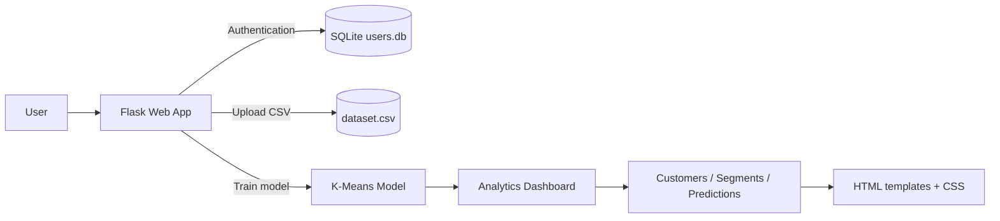
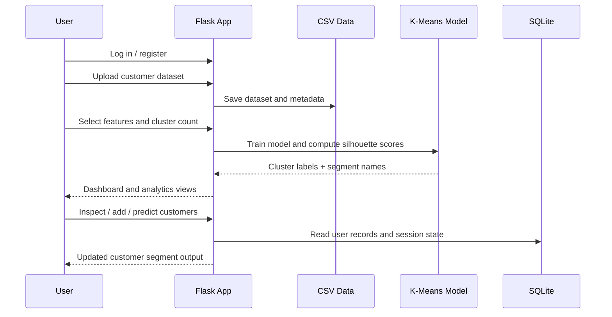

# Customer Segmentation using K-Means Clustering

Flask (Python) backend + HTML/CSS/JS interface.

## Features
- Login / register (passwords hashed, SQLite)
- Upload any customer CSV (or use the bundled sample)
- Choose features, automatic or manual K (silhouette-based), run K-Means
- Customers table: search, filter by segment, delete, download CSV
- Add new customers - automatically assigned to a segment
- Predict a segment for any set of values (without saving)
- Analytics: segment sizes, PCA cluster map, segment profiles, elbow/silhouette, metrics, insights

## System overview


## User workflow


## Run
```bash
python -m venv venv
venv\Scripts\activate          # Windows   (Mac/Linux: source venv/bin/activate)
pip install -r requirements.txt
python app.py
```
Open http://127.0.0.1:5000

## Login credentials
| Username | Password   |
|----------|------------|
| admin    | admin123   |
| analyst  | analyst123 |

You can also create accounts from the Register page.
Set a real secret key before deploying: `set SECRET_KEY=your-secret` (Windows) / `export SECRET_KEY=...`.

## CSV format
Header row + at least 2 numeric columns, e.g.
`CustomerID,Gender,Age,Annual Income (k$),Spending Score (1-100)`

## Structure
```
app.py              Flask app, ML logic, routes
templates/          HTML pages (Jinja2)
static/style.css    Styling
sample_data/        Sample CSV
data/               Generated at runtime (dataset, model, users DB)
```
Charts use Chart.js from a CDN, so the browser needs internet access for the analytics page.
